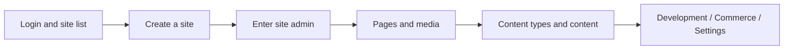

# Kooboo Admin (CMS)

> Configure sites, content, and integrations in the Kooboo console — for administrators and implementers

## What This Section Covers

You may already have read the [Template Engine](/en/templateEngine/) or [KScript API](/en/api/), but are unsure **where to click first in the admin**. This series follows the real Kooboo site-admin menu, explains configuration steps, and links to development docs.

::: tip Menus follow the product
After product upgrades, if menus change, use the admin UI you see after login as the source of truth.
:::

## Suggested Learning Order

The docs go from the **account-level console** (login, site list) to **inside a site** (pages, content, development, settings).



| Stage | Doc | You will complete |
|------|------|----------|
| 0 | [Login and site list](./getting-started/login-and-site-list.md) | Sign in, folders, enter **Manage** |
| 1 | [Create a site](./getting-started/create-site.md) | Blank / import / clone (AI builder not included) |
| 2 | [Site admin menu overview](./navigation.md) | Know which column each `SiteId` feature lives in |
| 3 | [Dashboard](./site/dashboard.md) · [Media Library](./site/media.md) | Site overview and image assets |
| 4 | [Pages](./site/pages.md) | Create visitable pages |
| 5 | [Content](./content/index.md) ([Content types](./content/content-types.md) · [Content list](./content/contents-folders-list.md)) | Prepare data for `k.content` |
| 6 | [Commerce](./commerce/index.md) (as needed) | Products, orders; see [k.commerce](/en/api/commerce/commerce.md) |
| 7 | [Development](./development/index.md) | Layout, View, Code, modules, etc.; see [Template Engine](/en/templateEngine/) |
| 8 | [Database](./database/index.md) | IndexedDB, KV, SQLite/MySQL/SQL Server, SQL logs |
| 9 | [Site settings](./settings/index.md) | Basics, domains, integrations, users/roles, hooks, Cookie, AI |

## How This Connects to Development Docs

| What you do in the admin | Read next |
|------------|----------|
| Create content types and content folders | [k.content](/en/api/content/) |
| Products, orders, carts | [k.commerce](/en/api/commerce/commerce.md) · [Commerce admin](./commerce/index.md) |
| Create Layout / Page / View | [Template Engine](/en/templateEngine/) |
| Create IndexedDB tables, view SQL logs | [Database](./database/index.md) · [k.DB](/en/api/database/) |
| Configure domains, payment, database connections | [Site settings](./settings/index.md) · [k.payment](/en/api/payment/) |
| Enable multilingual, maintain Labels | [k.label](/en/api/label/) · [Template binding](/en/templateEngine/binding/) |

## Two URL Levels

| Level | When to use | Example |
|------|----------|------|
| **Account level** | Site list, create site | `https://www.redev.cn/_Admin/`、`/_Admin/create` |
| **Site level** | Inside a site admin | `/_Admin/site/pages?SiteId={siteGuid}` |

Site-level deep links are written as:

```text
/_Admin{path}?SiteId={yourSiteId}
```

See [Menu overview](./navigation.md) for details.

## User Manual

For click-by-click UI guidance with screenshots:

- [Edit a Page Visually](./manual/edit-page.md) — change a heading, replace an image, and set alt text on the preview canvas

More chapters: [User Manual home](./manual/).

## Related

- [Login and site list](./getting-started/login-and-site-list.md)
- [Create a site](./getting-started/create-site.md)
- [Menu overview](./navigation.md)
- [Content](./content/index.md)
