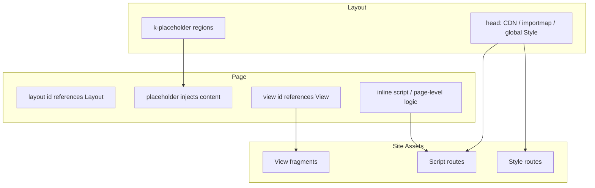

# Template Engine

> How Kooboo organizes and renders pages, layouts, views, and routed static assets.

## Overview

In Kooboo:

- **Page** defines an addressable HTML page.
- **Layout** provides the shared page skeleton such as `<head>`, navigation, and placeholder regions.
- **View** is a reusable HTML fragment.
- **Script** and **Style** are independent `.js` and `.css` assets with their own site routes.

Server-side data binding is handled through `env="server"` and directives such as `k-content` and `k-for`. Declarative data queries are handled by `k-data`.

## Resource Relationship

| Resource | Responsibility | Has its own URL route? |
|----------|----------------|------------------------|
| [Layout](./layout/) | Shared HTML skeleton and `k-placeholder` regions | No |
| [Page](./page/) | URL page, selected layout, injected content | Yes |
| [View](./view/) | Reusable blocks such as headers, cards, and lists | No |
| [Script](./js/) | Importable JavaScript and frontend interaction | Yes |
| [Style](./css/) | Global or page-level stylesheets | Yes |

## Docs In This Section

| Topic | Description |
|-------|-------------|
| [Layout](./layout/) | Shared shell and placeholder regions |
| [Page](./page/) | Standalone page vs layout-based page |
| [View](./view/) | Reusable fragments inserted by `<view id="...">` |
| [Script](./js/) | Site JS resources and `type="module"` usage |
| [Style](./css/) | Site CSS resources and how they pair with Tailwind |
| [Template Binding Syntax](./binding/) | `env="server"`, `k-content`, `k-for`, and related directives |
| [k-data](./k-data/) | `<k-data>`, `<query>`, and JSON5 conditions |

## Responsibility Boundaries

| Scenario | Doc |
|----------|-----|
| Write layout, placeholders, and view references in an HTML template | This `templateEngine/*` section |
| Create, update, or delete site resources with KScript such as `k.site.pages` | [k.site](/en/api/site/) |
| Render navigation menus with `<menu>` or `k.site.menus` + `k-for` | [k.site.menus](/en/api/site/menu) and [CMS: Menus](/en/cms/development/menus) |
| Call external OpenAPI services | [k.openApi](/en/api/openapi/) and [CMS: Open API](/en/cms/development/openapis) |
| Fetch multilingual dictionaries from an SPA frontend | [SPA Multilingual API](/en/api/spa-multilingual/) and [CMS](/en/cms/development/spa-multilingual) |
| Build installable modules with routes and view/api resources | [k.module](/en/api/module/) and [CMS: Modules](/en/cms/development/modules) |
| Schedule recurring jobs | [k.site.runJob](/en/api/site/job) and [CMS: Scheduled Jobs](/en/cms/development/jobs) |
| Change the current request title or metadata | [k.page](/en/api/page/) |

## Data Querying

- [k-data](./k-data/) - declarative data flow with `let`, `query`, `map`, and `export`
- Historical `k-query` is deprecated; old URLs redirect to k-data
